# iopix

*A web companion for your digiKam library.*

A web front end for a digiKam library, for browsing, searching and managing photos from any browser: FastAPI + a single-page vanilla JS app. It reads digiKam's database and your photos, keeps everything it builds in its own `data/` folder, and writes to the library only for the editing features you turn on.

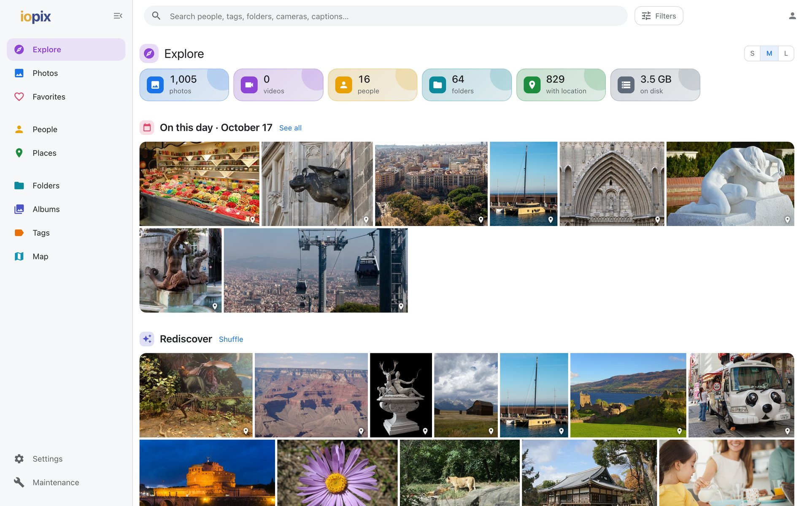

| | |
| --- | --- |
| 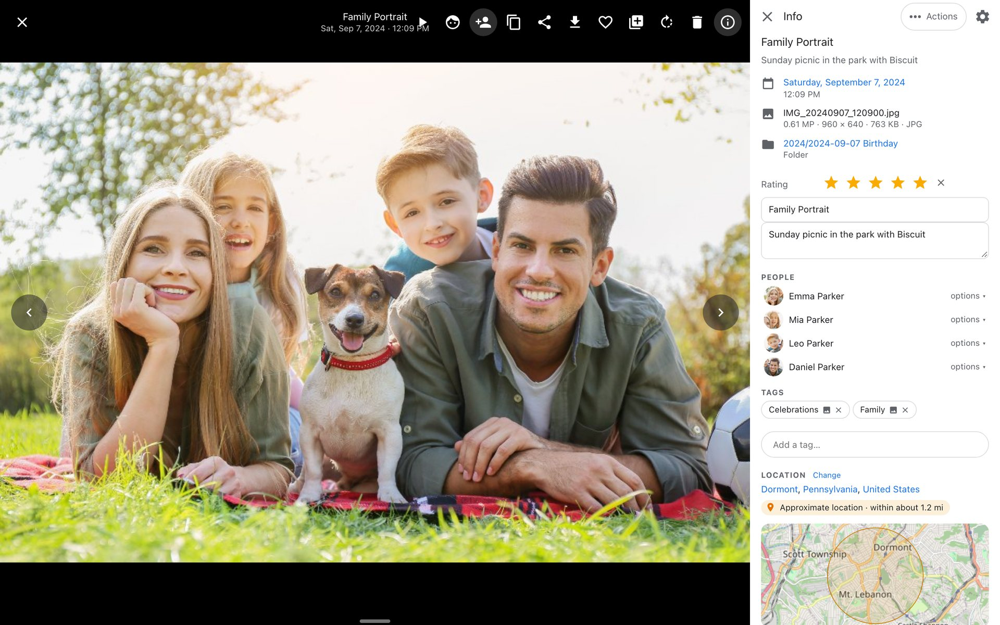 | 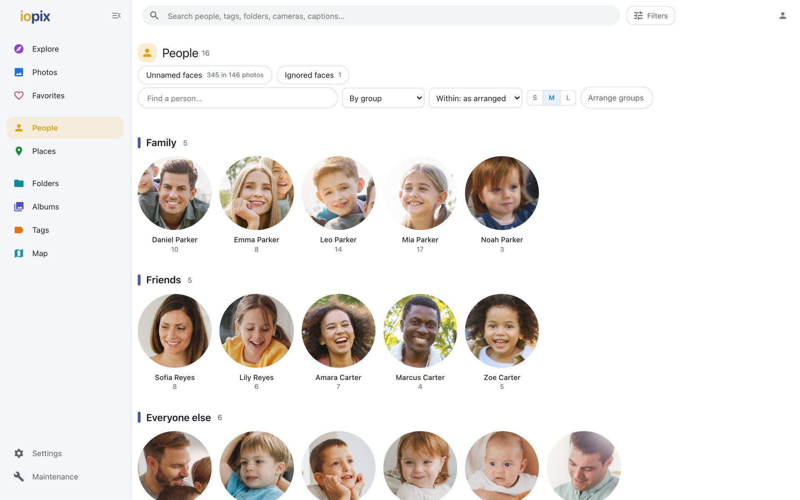 |
| **Viewer** with the info panel: rating, caption, faces, tags, location | **People** from digiKam's face regions |
| 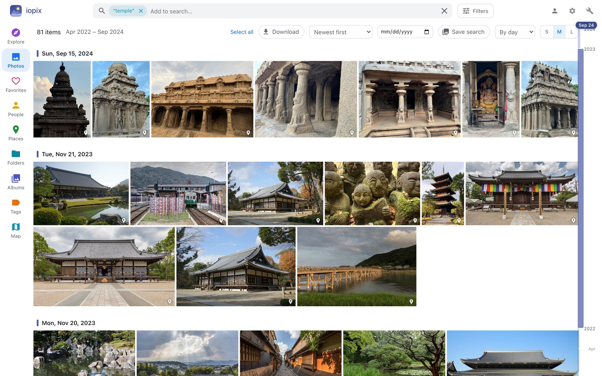 | 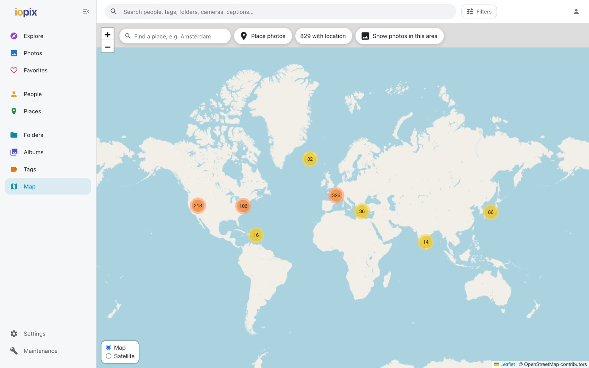 |
| **Search** by what is in the photos | **Map** of every geotagged photo |
| 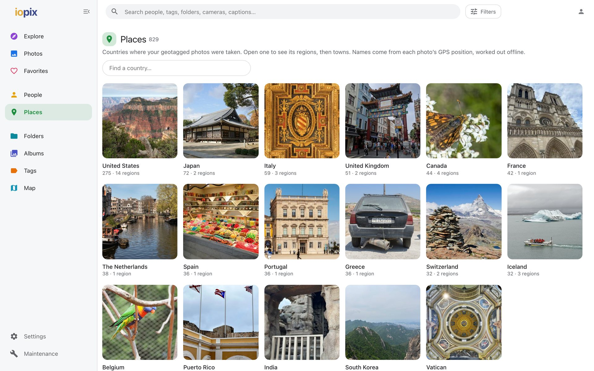 | 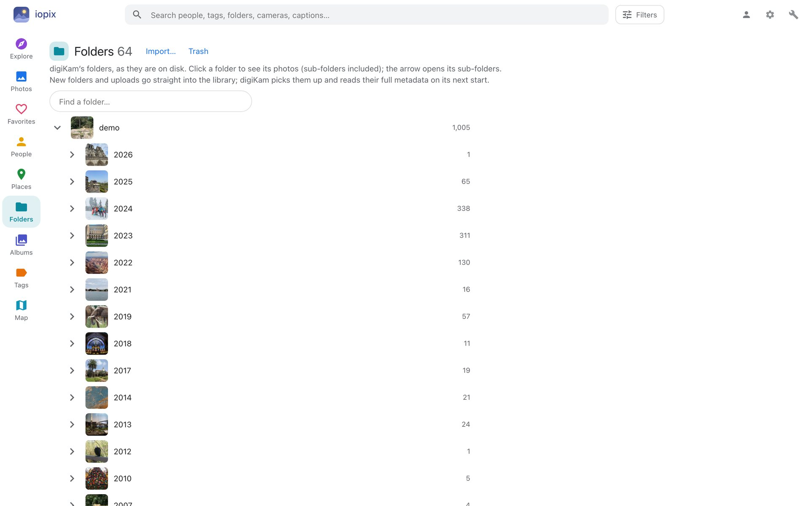 |
| **Places** worked out offline from GPS positions | **Folders** as they are on disk |
| 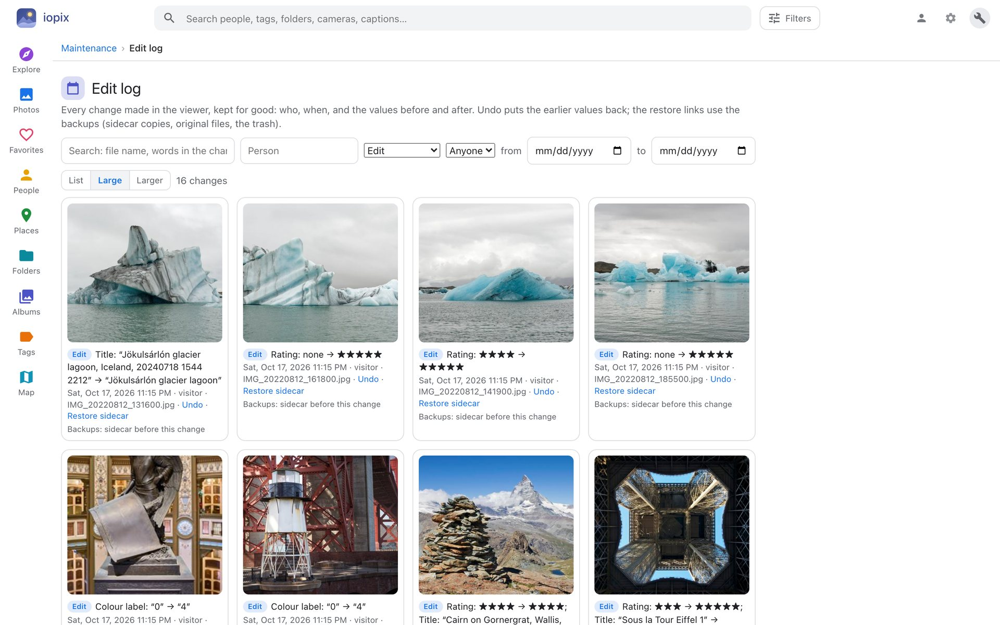 | 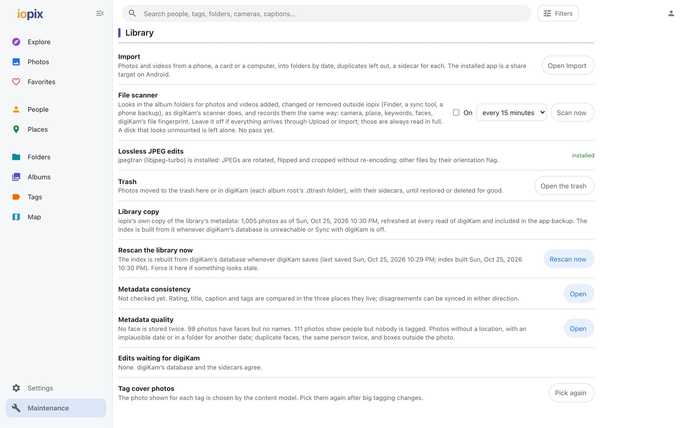 |
| **Edit log** with undo for every change | **Maintenance** |

<p>
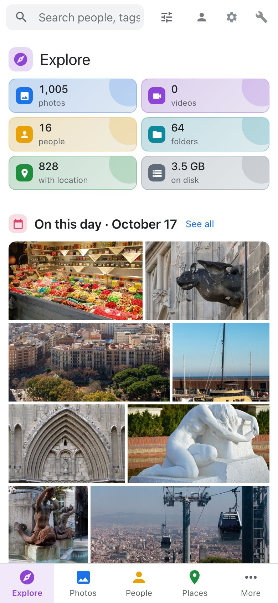

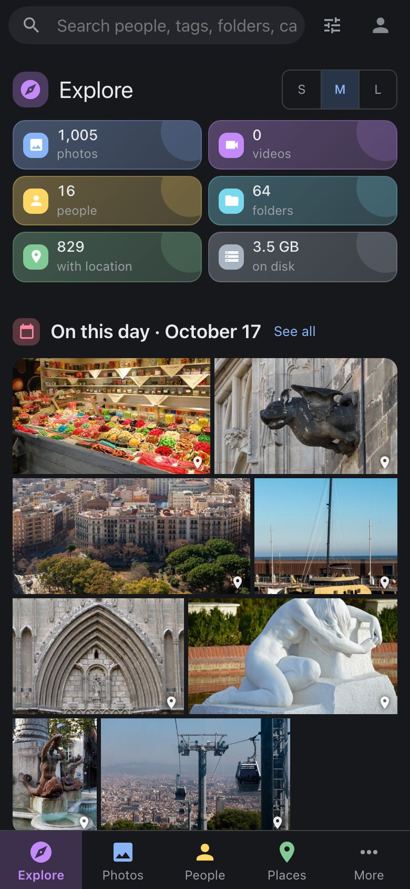
</p>

## Run

```sh
git clone https://github.com/avandeputte/iopix && cd iopix
./setup.sh
```

`setup.sh` is the installer: it asks where the photos are, whether digiKam's database is the SQLite file or MySQL/MariaDB (and tests the connection), which features you want (content search, places, objects, text recognition, descriptions; each downloads its model), the port, an admin account, and whether to start the viewer at login (launchd on macOS, systemd on Linux). Then it creates the Python environment, installs the packages, downloads the models, writes `iopix.env`, creates the admin and starts the service. Run it again at any time to add a feature; it keeps what is there. Flags skip the questions (`./setup.sh --help`), e.g. `./setup.sh --yes --photos /srv/photos --mysql db:3306/digikam:digikam:secret --features search,places --admin alex:secret`.

It also installs what the viewer needs from the system when it is missing: Python 3.10+, `exiftool` (metadata editing), `ffmpeg` (video thumbnails), `jpegtran` from libjpeg-turbo (lossless JPEG rotate and crop) and the MariaDB client (`mysqldump`, to back a MySQL/MariaDB digiKam database up before writes), with Homebrew on macOS (offering to install Homebrew first) or apt/dnf/zypper/pacman on Linux (`--no-system-deps` to skip). Without the service, `./run.sh` starts it in the foreground.


## Optional features

All chosen in `setup.sh` (or later from Maintenance › AI analysis and models); each is a package plus a model downloaded into `data/models`:

| Feature | What it adds | Download |
| --- | --- | --- |
| Content search | find photos by what is in them; "Detected content" | SigLIP 2 base ~1.5 GB, CLIP ViT-B/32 ~600 MB or Jina CLIP v1 ~900 MB |
| Places | town, region, country for GPS positions, offline | GeoNames ~30 MB |
| Object detection | people, animals, vehicles, everyday objects with boxes | YOLOX-S 35 MB (or M 101 MB, L 217 MB, X 396 MB) |
| Text in photos | signs, jerseys, documents searchable | RapidOCR ~60 MB |
| Face grouping | look-alike unnamed faces grouped, with "looks like" name suggestions | SFace 37 MB (or ArcFace ResNet-50 174 MB) |
| Face detection | faces nothing has marked yet, added as unnamed faces (on request) | YuNet 0.2 MB (or SCRFD 10G 17 MB, RetinaFace ResNet-50 104 MB) |
| Photo descriptions | one sentence per photo, searchable | BLIP base ~950 MB (or BLIP large ~1.9 GB) plus PyTorch (CPU build ~1 GB) |

Where a feature can run on more than one model, the default is the small, fast one and the menu in the Model column of Maintenance › AI analysis and models switches to a larger, more accurate one (downloaded once; the sizes and speeds are shown there):

| Feature | Default | Alternatives | What changes when you switch |
| --- | --- | --- | --- |
| Content search | CLIP ViT-B/32 (SigLIP 2 on new installs) | SigLIP 2 base (a little better on average, 4x slower to index), Jina CLIP v1 (longer, more natural queries, 3x slower) | the library is indexed again with the new model in the background; search stays on the old index until that finishes |
| Object detection | YOLOX-S (40 AP on COCO) | YOLOX-M (47 AP, 3x slower), -L (50 AP, 6x), -X (51 AP, 10x) | new photos use it at once; "Run again" redoes the whole library |
| Face detection | YuNet (80% on the hard WIDER Face set) | SCRFD 10G (95%, 10x slower; InsightFace), RetinaFace ResNet-50 (84% hard, the slowest) | the next detection run uses it |
| Face grouping | SFace (128-d, on the raw crop) | ArcFace ResNet-50 (512-d, WebFace600K; InsightFace), each face aligned on its eyes, nose and mouth first with the chosen face detector; much better at telling people apart (on a sample of confirmed faces, mean cosine similarity: same person 0.71 vs different people 0.05, where SFace gives 0.75 vs 0.38), 5x slower | every face is embedded again in the background |
| Photo descriptions | BLIP base | BLIP large (richer sentences, 3x slower) | new photos use it at once; "Run again" redoes the whole library |

SCRFD and ArcFace come from InsightFace's `buffalo_l` pack (a 289 MB zip); only the one file each needs is kept.


## Browsing

The viewer is a web app that installs like an app on a phone or tablet (PWA): open it in the browser and choose "Add to Home Screen" (iOS Safari) or "Install app" (Android Chrome, desktop Chrome/Edge). The layout adapts to narrow screens: the top bar and dialogs stay clear of the notch and the home indicator, the bottom bar carries Photos, Explore, People and Search with the rest (Favorites, Folders, Albums, Tags, Places, Settings) under More, dialogs open as sheets from the bottom, the selection bar shows its actions as icons, and photos are swiped through; a service worker keeps the app shell available, but photos and search always come from the server, so nothing shown is ever stale. Settings › Name sets what the viewer calls itself (the top bar, the tab title and the installed app's name; the default is iopix).

- **Photos**: the whole library as one virtualised timeline grouped by day, with a year scrubber, three tile sizes and several sort orders.
- **Search**: instant suggestions for people, tags, albums, cameras, lenses, photographers, places, years and months; Enter for full-text search across file names, albums, titles, captions, tags, people, recognised text and descriptions. Every pick becomes a chip; chips combine. With content search on, "Photos that look like…" searches by description.
- **Filters**: every piece of metadata for the current results with live counts: type, rating, date range, years, people, tags, albums, location, camera, lens, ISO / aperture / focal length, photographer, file type, plus the analysis filters below.
- **Explore, People, Folders, Albums, Tags, Places, Map**: face-crop avatars from digiKam's face regions, the folder tree (digiKam's albums on disk; editors can create folders and upload photos into them, which digiKam then scans fully on its next start), the viewer's own albums (groupings that live only in the viewer), the full tag tree, places from country to town, and a clustered map of geotagged photos ("Day's trail" draws a day's route).
- **Explore** also lists: Duplicate files (byte-identical files, by digiKam's content hashes), Bursts & best shots, Events & trips, Detected content, Edited here not yet in digiKam.
- **Viewer**: zoom and pan (switches to the original file when zoomed in), keyboard and swipe navigation, a film strip of the neighbouring photos along the bottom edge, slideshow, face boxes, object boxes, video playback, download, Share (the device's own share sheet with the picture attached where the browser has one, else a menu with the links) and an info panel with all metadata, each value a link to matching photos: your own title and caption first, then date, file, people, tags and location; the camera, lens and exposure low in the panel in small type; everything the models produced (description, detected content, objects, text, sharpness, similar photos) together at the end under "AI analysis". Settings › Display › Info panel, or the gear at the top of the panel, chooses which sections show, saved with the account.
- **Appearance**: Settings › Display chooses light, dark or the device's theme and whether thumbnails carry badges (faces, GPS, favorite); saved with the account when signed in, else in the browser. Light is the default; dark or following the device are a choice in Settings.
- **Smart albums**: any filter combination can be saved from the bar above the grid ("Save search") and appears under Albums as a smart album that updates itself; the timeline rail on the right shows a density ribbon (how many photos each month has), a marker naming the month you are at, and on hover a preview of that month with a few thumbnails; it also shows months when the list spans a few years, and a date box in the bar jumps to a day.
- **Keyboard tagging in the viewer**: 0–5 rate, L favorites, T opens the tag dialog (recent tags first), P names the next unnamed face (or lets you draw one), F/O toggle faces and objects, I the info panel.
- **Similar photos** (Explore › Duplicate files): resized, re-saved or burst-neighbour copies found from the content-search embeddings at a chosen strictness, sharpest copy first; the byte-identical sets stay above it. Nothing is ever deleted by the viewer.
- **Face grouping and suggestions** (People › Faces › Unnamed faces): with the SFace model (Maintenance › AI analysis and models, 37 MB) the unnamed faces digiKam found are shown in look-alike groups, each named or ignored in one go, and each group or face carries the viewer's own "looks like" guess (from the most recent confirmed faces of every named person) with a one-click name. A guess is written nowhere until you accept it.
- **Select, favorite, collect**: hover a tile and click its check mark (shift-click for a range, the check on a day header for the whole day, or "Select all"). The selection bar can favorite, add to an app album, tag, edit, set a location or download. Favorites and "My albums" live in `data/viewer.db`, never in digiKam.
- **Download as zip**: "Download" zips the originals of the current search, album or selection, keeping the album folder structure, optionally with XMP sidecars, streamed without temp files. The whole library is never offered as one download. Large downloads are split into parts of 1, 2, 4 or 8 GB (2 GB by default; the API accepts `part_mb` from 100 to 16000) that unzip into one folder.


## AI analysis and background jobs

All analysis runs locally and is stored in `data/viewer.db`; nothing is written to digiKam. New and changed photos are picked up automatically (the digiKam database is polled every `REINDEX_POLL` seconds, 20 by default). Maintenance › AI analysis shows every job with progress, "Check for new photos now" and "Run again from scratch".

Heavy work runs through one queue, one job at a time, in this order: thumbnails, sharpness/exposure/objects, content-search embeddings, text and face quality, face grouping, similar photos (when asked for), descriptions. Each job may use `BG_THREADS` cores (default half the machine, changeable in Settings; a change applies when the next job starts), so the viewer and other apps stay responsive.

| Job | What you get |
| --- | --- |
| Sharpness and exposure | measured on a ~1000 px decode: Sharpest / Blurry / Very dark / Very bright filters, "Sharpest first" sort; sharpness shown as a rank within your library |
| Object detection | YOLOX (S by default; M, L or X as an option), 80 everyday object types with boxes; Objects and "people in the picture" filters; O in the viewer |
| Content search | SigLIP 2, CLIP or Jina CLIP embeddings: text search by description, "More photos like this", Detected content, tag cover photos |
| Text in photos and face quality | RapidOCR text, searchable from the search box; face quality as the sharpness of digiKam's face regions. |
| Face grouping and suggestions | SFace (or ArcFace, aligned on the landmarks) embeddings of every face that has no name yet (whoever marked it) and of each person's recent confirmed faces: look-alike groups on People › Faces with a "looks like" suggestion and one-click naming |
| Face detection | YuNet (OpenCV, 0.2 MB, onnxruntime; or SCRFD 10G or RetinaFace ResNet-50, chosen in Maintenance) finds faces nothing has marked yet, on request only: a photo (info panel › People › detect faces), a folder (the face button on its row in Folders, subfolders included) or the whole library (Maintenance › AI analysis and models › Run). Every existing face region, named, unknown, suggested or ignored, from digiKam or any other tool, is honoured: a detection that overlaps one (centre inside it, or a third of the smaller box covered) is the same face and is not added, even when the rectangles differ. New faces are written to digiKam's database the way digiKam writes an unnamed face, so they appear under People › Unnamed faces with a "looks like" suggestion. The library run remembers which photos it looked at and next time checks only new and changed ones; "Run again" looks at every photo again |
| Photo descriptions | one sentence per photo from BLIP base (or BLIP large), through PyTorch on an Apple GPU when there is one, else on the CPU (about 0.5 s per photo); searchable and shown in the info panel. `CAPTIONS=0` turns the job off |
| Similar photos | on request from Explore › Duplicate files: resized, re-saved and burst-neighbour copies found from the content-search embeddings |

Derived from these:

- **Detected content**: Explore › Detected content files photos under 752 everyday subjects in 13 groups (landscapes, buildings, rooms, people, events, soccer, other sports, animals, food, vehicles and travel, objects, documents, photo style). These are guesses from the embeddings, not stored labels.
- **Bursts & best shots**: frames taken within 2 seconds on the same camera that also look alike (embedding similarity ≥ 0.80 when content search is on) are grouped; the best frame is the sharpest, nudged by face quality. "Show only the best frame of each burst" is a filter.
- **Events & trips**: trips are runs of days photographed more than 75 km from the town where most of your photos are taken; events are other days with 20 or more photos, named after the title most of them share, else their main tag, else the town.
- **Search model**: `setup.sh` proposes SigLIP 2 (CLIP indexes about 4x faster); the Docker image and the installers download SigLIP 2 first and use it; with neither chosen the viewer uses CLIP. Switch between installed models under Maintenance › AI analysis; the library is re-indexed in the background and search switches when complete. You can switch back at any time.

## Updating

- **Standalone (checkout or the Linux installer):** `./update.sh` in the app folder (`/opt/iopix/app` after the installer). It pulls the latest code (git, or the GitHub tarball when there is no `.git`), keeps `iopix.env`, the data folder and the Python environment, reinstalls the package groups that are already installed, and restarts the service (launchd or systemd). `./update.sh --check` only reports; `--force` reinstalls even when nothing is newer; `IOPIX_REF=<sha>` installs that commit. When the installed commit is already the one asked for, the script says so and does not restart.
- **Proxmox:** `update` inside the container (the framework's command) runs the same script.
- **Docker:** `docker compose pull && docker compose up -d`.
- **From an MCP client (e.g. Claude):** the `check_for_update` and `update_viewer` tools (`update_viewer` takes an optional `ref`, the commit to install; give it the sha just pushed, because GitHub can still report the previous commit for a short while, and `check_for_update` then shows the outcome under `lastUpdate`); the latter needs the admin token shown under Maintenance › Viewer version › MCP update token (or `MCP_ADMIN_TOKEN` in the environment), because the MCP endpoint has no sign-in of its own; the diagnostics tools take the same token. Treat the token like a password.
- **Daily check:** with Settings › Check for updates daily (on by default; `UPDATE_CHECK=0` locks it off) the viewer asks GitHub once a day whether a newer version exists and shows admins a banner with a link to the update; only the public commit list is fetched, nothing about the install is sent.
- **Server log:** Maintenance › Viewer › Server log shows the end of the viewer's own log (`data/viewer.log`), filtered by level or text, with page requests hidden unless asked, and downloads the whole file. Edits applied to digiKam's database, refusals and failures are logged there.
- **From the app:** Maintenance › Viewer version shows the installed commit, "Check for updates" compares it with GitHub's main branch, and "Update now" runs `update.sh` (not in Docker, which says to pull instead). The viewer restarts itself when the update finishes.

## Users and permissions

Out of the box the viewer is open to anyone who can reach it. `setup.sh` asks for the admin account; Settings offers **Create the admin account** later (or set `ADMIN_USER` and `ADMIN_PASSWORD` for a container, or run `.venv/bin/python -m app.users create <name> <password> admin`). Once a user exists:

| Who | Can |
| --- | --- |
| Not signed in | browse and search everything, read-only; display settings stay in the browser |
| **viewer** | the same, plus settings, favorites and albums kept on the server (they follow the user to another device) |
| **viewer without a password** | the same; signs in with one click from the account picker (like a media-server profile). An account with no password can never be more than a viewer |
| **editor** | plus every library write: edits, tags, faces, place tags, GPS tracks, metadata sync, applying to digiKam's database |
| **admin** | plus settings, maintenance, models, backups, updates and managing users (Settings › Users) |

**Albums are shared or private.** A shared album is seen by everyone who can browse, and only editors and admins create, rename, fill, share or delete it. A private album is seen and changed only by the account that made it, whatever its role (admins do not see other people's private albums); any signed-in account can make one. An editor or admin can share their private album, or make a shared album private, which makes it theirs. Albums from before v1.27 are shared. With no accounts yet, every album is shared.

**Require sign-in** (Settings › Users) turns the open browsing off: visitors get the sign-in screen and nothing else; no thumbnail, preview or API answer is served without an account. With it on, an MCP client must send the admin token as a header, `Authorization: Bearer <token>` (in Claude Desktop's `mcp-remote` config: `"args": ["mcp-remote", "https://…/mcp", "--header", "Authorization: Bearer <token>"]`).

**Viewer database on MySQL/MariaDB** (Settings › Viewer database, admin): by default the viewer keeps its own data in `data/viewer.db` (SQLite). It can use a MySQL/MariaDB database of its own instead (give it its own database, e.g. `iopix`, not digiKam's): test the connection, tick "copy all the data" (and "drop and recreate" for a clean slate), and Switch; every row is copied across and the viewer restarts on the new database. The connection settings live in `data/viewer-db.json` (or `VIEWER_DB_TYPE`, `VIEWER_DB_HOST`, `VIEWER_DB_PORT`, `VIEWER_DB_DATABASE`, `VIEWER_DB_USER`, `VIEWER_DB_PASSWORD`), outside the database itself. If that server is unreachable at start, the viewer falls back to the SQLite file and says so in Settings. The backup zip always contains a SQLite copy, whichever is in use, so switching back is the same procedure in reverse.

Each account can be linked to a person from People by an admin (Settings › Users; an admin can also link their own account from the account dialog). Only admins link accounts, because a linked person's face is shown on the sign-in screen. That person's face badge becomes the account's avatar in the account picker and the menu. Each account can also carry an optional email address (Settings › Users). A reverse proxy that authenticates users (Authelia, Authentik, Cloudflare Access…) is mapped onto these accounts by the email it passes (see Sign-in at the proxy).

Sign in from the person icon at the top right: the dialog shows a tile per account; a passwordless viewer signs in with one click, the others ask for their password. Sessions are signed HttpOnly cookies (secret in `data/secret`) valid for 30 days; passwords are scrypt-hashed and never stored in clear. The server enforces all of it: write endpoints answer 401/403 regardless of what the page shows. Read-only mode (an admin setting) still refuses library writes for everyone, editors included.

## Editing

Off by default in the sense that nothing is written until you act; `EDITING=0` removes the controls, `READ_ONLY=1` (or the switch in Settings › Display) locks the whole viewer to browsing and refuses every write endpoint.

Rating, title, caption and keyword tags can be changed in the info panel, with keys in the viewer, or for a whole selection with Edit. Dates, locations, metadata templates, place tags, GPX tracks, faces and the tag manager (below) use the same engine.

**Where edits go, in order:**

1. **XMP sidecar** (`photo.jpg.xmp`), rewritten with exiftool, setting the same fields digiKam writes (checked against digiKam 9.1.0: rating, titles, captions, every tag-path namespace, always the complete tag list). exiftool rewrites the whole sidecar in its own layout (same data, different formatting).
2. **Image file** (optional, Settings › Editing › "Write metadata into image files", like digiKam's "sidecar and file" mode): embedded XMP plus the EXIF, IPTC and JPEG-comment fields digiKam uses. JPEG, PNG, TIFF and WebP only. Only the metadata block changes; pixels are untouched. digiKam notices the changed files and rescans them.
3. **digiKam's database**, only when you ask: "N edits not in digiKam yet" in the left rail or Explore › "Apply edits to digiKam database". Requires digiKam closed (see `DIGIKAM_CHECK`), backs the database up first, applies everything in one transaction and checks integrity before committing. `DB_WRITE=0` disables this. Until then the viewer shows your change and remembers it in `data/viewer.db`; digiKam picks sidecar changes up itself with Item › Reread Metadata From File, at which point the remembered edit is dropped. If you change an edited item in digiKam before that, digiKam may write its own values over the sidecar.

Tag and face operations, place-tag creation and tag badges write the database directly because digiKam owns those tables. When the viewer rewrites a sidecar with what digiKam's database already holds (face regions, a renamed tag, applied edits), it also sets that photo's `Images.modificationDate` to the sidecar's new time, as digiKam does after writing metadata itself (an image file rewritten in place is left to digiKam's own rescan, which also recomputes its uniqueHash): digiKam's scanner rescans any file whose time or size no longer matches, and re-imports its face regions, which is one way a face ends up stored twice. Ordinary changes take no full database backup (since v1.28: a full copy on every change made them slow); each is recorded in the change log. A full backup is taken only before deleting photos, deleting a tag, or merging changes made with sync off.

### Dates, locations, templates, place tags, GPX, faces

The location dialog has a place search: an address or landmark ("Mt Lebanon High School") is looked up on OpenStreetMap's Nominatim through the server (one request per second, results cached; only the typed text is sent), and the result is placed on the map; without a connection it falls back to the offline GeoNames towns. A pasted "latitude, longitude" pair fills both fields.

Maps use OpenStreetMap by default (nothing to set up). Settings › Map provider can switch to **Google Maps** with your own API key: create a key in the Google Cloud console with the *Map Tiles API* and the *Geocoding API* enabled and billing on, restrict it to the viewer's address (HTTP referrer), and paste it in Settings (or set `GOOGLE_MAPS_API_KEY`). The server then creates the tile session and the browser loads Google's tiles; place search goes to Google's geocoder; the "open in" link in the info panel points at Google Maps. The key is stored in the viewer's settings and never shown back; if Google refuses the session, the viewer says so and falls back to OpenStreetMap.

- **Location**: info panel or Edit › Set location. Search by name or address (Google's Geocoding and Places APIs when Google is the map provider, OpenStreetMap otherwise and whenever Google finds nothing or refuses: a key restricted to browser referrers is refused by Google's server-side APIs, and the dialog says so), click the map, drag the pin, or paste coordinates. "Suggest location" lists the places of the photos taken nearest in time (within 6 hours; one entry per spot, with how long before or after), and on request asks Google Cloud Vision to recognise a landmark in the photo (a 1024 px preview is sent; needs the Cloud Vision API enabled and a key Google accepts from a server). The altitude fills in with the ground height at that point (Google's Elevation API, else Open-Meteo's terrain model) unless you type one.
- **The picture itself is never touched**: before a metadata write into an image file (Settings › Write metadata into image files), exiftool hashes the file's image data only (`ImageDataHash`, SHA-256: the compressed pixels, metadata excluded) and a copy is set aside; after the write the hash is taken again. A write that changed the image data is undone (the copy goes back), counted as failed, logged and recorded in the photo's change log. Verified hashes are kept in `image_data_checksums`. Needs exiftool 12.58 or newer; older ones are noted in the log and writes proceed unverified.
- **Edit log**: every change the viewer makes to a photo is kept for good in `photo_history`: when, who (the signed-in user), what, the values before and after. Edits, face changes, tag renames and deletions, syncs, writes into digiKam's database, uploads, deletions and restores all appear. The info panel shows a photo's last changes (section "Change log", one of the sections you can hide), `#/history` (Maintenance › Change log) the whole library's. Each entry offers what can be brought back: **Undo** (the values from before, applied as a new edit), **Restore sidecar** (a copy of the sidecar taken just before that change, kept in `data/history/`), **Restore original file** (the image file as it was before the viewer first wrote into it, from `data/file-backups/`), **Restore photo** (a deleted photo's files put back from `data/deleted-photos/` and the photo added to the library again, with its rating, title, caption and tags). A restore needs its backup to still be there and is itself logged.
- **File scanner** (Maintenance › File scanner; off by default): looks in the album folders for photos and videos added, changed or removed outside the viewer (Finder, Syncthing, a phone backup) and records them as digiKam's collection scanner would (CollectionScanner/ItemScanner, digiKam 9.1). New folders get their Albums rows; new files get the full rows of a digiKam scan (dimensions, format, camera and lens, position, title, caption and headline, copyright, keywords, pick and color labels, face regions, video details) and digiKam's own file fingerprint (`uniqueHash`, DImg::createUniqueHashV3, identical to digiKam's on every file checked); a file identical to a known one takes that photo's attributes; files whose time or size changed get digiKam's modified-file scan (dimensions, format, hash, time); files that vanished get status 3 with no album, as digiKam leaves them. A root that is missing or empty, or a pass that would remove a large share of a folder tree, is skipped and reported (an unmounted disk must not empty the library). Runs every 5 minutes to once a day while on, skips a pass while digiKam is running, and Scan now runs one on request. Photos added through Upload or Import are always read in full this way at once, scanner on or off.
- **Folder properties** (Folders › a folder's info button; editors): caption, date, category and cover photo, stored in digiKam's own Albums row (`caption`, `date`, `collection`, `icon`), so digiKam's Album Properties show the same. The caption and category appear under the folder's name; the chosen cover is the folder's picture (otherwise the best-rated photo). The viewer's info panel offers "Use as folder cover" for the photo on screen.
- **No interruptions**: when the library changes (an edit, digiKam, a background job), list pages redraw in place and the map refreshes its markers without moving or closing the placing tray; pages with work in progress keep what is on screen. A new version of the viewer loads when the tab is in the background or at the next change of page, with a "Load it now" note meanwhile.
- **Satellite and Street View**: every map (the Map page, Set location, Place photos) has a Map / Satellite switch (Google imagery with labels when Google Maps is configured, otherwise Esri World Imagery), remembered. Street View is offered in Set location, in the info panel's location and on a found place's pin: embedded when the Google key has the Maps Embed API enabled, otherwise it opens Google Maps' Street View in a new tab.
- **Placing photos on the map** (Map › Place photos; editors): a tray lists the photos without a location (the current search and filters apply); find a place, landmark or address (the map zooms to street level and drops a pin; right-click elsewhere moves it), select photos (Shift for a range; a slider sets the thumbnail size) and click the map or the pin's button, or drag them onto the map. While placing, single markers can be dragged to a better spot. Every change is an ordinary location edit (sidecar, digiKam's database, the change log) with Undo in the message.
- **Download** (the selection bar's Download, a folder's or search's download button): the zip download makes copies on request: resized (long edge 4096, 2048 or 1280 px), converted to JPEG (HEIC, PNG, TIFF, WebP), named by date (`2026-10-17_143205`, `2026-10-17_IMG_1234`, `2026-10-17_001`), all in one folder, and without the location (GPS and place names removed from photos and videos). Converted copies are upright and keep their dates, camera details, keywords and captions (exiftool copies them from the original). The library files never change; with no option chosen the originals go in as they are.
- **Rename by date** (selection bar; editors): renames the selected files in their folders by the date taken (date and time, date and original name, or date and number); each is an ordinary rename (id kept, sidecars along, change log), and Undo in the message puts all the names back.
- **All metadata** (viewer › info panel › File › All metadata): every EXIF, GPS, IPTC and XMP field of the file and of its sidecar, grouped and filterable, as exiftool reads them. Editors change values in place or add a field: XMP fields are written to the sidecar (and into the file when Settings › Write metadata into image files is on); EXIF, GPS and IPTC fields live only in the file, so they need that setting. File writes are backed up and checked by the pixel guard. Afterwards the photo's rows in digiKam's database are read again from its metadata, and the change is in the change log with the sidecar and the original file kept for restore. "Reread from file" is digiKam's Read Metadata From File.
- **Copy metadata** (selection bar, two or more photos; editors): pick the photo to copy from and the fields (rating, labels, title, caption, keywords, location, date taken, creator and copyright); they are applied to the others through the normal edit path, each change in the change log with undo.
- **Adjust as a new version** (viewer › rotate button › Adjust; editors): exposure, contrast, saturation, warmth, straighten and auto levels, previewed on screen and rendered at full size into `name_v1.jpg` beside the original (JPEG, quality 95, colour profile kept), with the original's metadata, sidecar and library attributes (face regions too unless straightened). The two are linked as digiKam links versions (an `ImageRelations` DerivedFrom row and its Original / Current Version tags), so digiKam's versions view groups them; the info panel lists the versions. The original file is never changed.
- **Import** (Folders › Import, Maintenance › Import, the More sheet on phones; editors): drop photos and videos, choose them, or take one. They go into folders by the date they were taken, under the library root, in the layout of your choice (`2006/200610` like digiKam, `2006/10`, `2006/2006-10-16`, `200610` or `2006`; admins can make one the default). A file already in the library (same size and contents) is left out, with a link to the photo it duplicates. Each new file gets a sidecar holding its own metadata (`exiftool -tagsfromfile`), is registered as an upload is (digiKam reads the full metadata on its next run) and is in the change log. On Android the installed app is a share target: sharing photos to it opens Import with them ready. iOS has no share target for web apps; the Import page's picker reads the photo library instead.
- **Rotate, flip and crop without loss** (the rotate button in the viewer, `[` and `]`, or the selection bar's Rotate for many photos; editors): a JPEG's pixels are turned by `jpegtran` in the compressed domain (nothing decoded or re-encoded; first to upright if an orientation flag was set, then as asked; the flag becomes normal, the stale embedded thumbnail is dropped), as digiKam's own lossless rotation does. Any other file (PNG, TIFF, WebP, HEIC, RAW, or a server without jpegtran) is turned by its orientation flag: in digiKam's database, in the sidecar and, for formats the viewer writes into, in the file under the pixel guard. Crop (viewer › rotate button › Crop…: drag a rectangle, adjust its corners, Crop) uses `jpegtran -crop` for JPEGs (the origin snaps to the 8 or 16 pixel block grid, so the result can be a few pixels larger than drawn; the far edges stay) and Pillow for PNG, TIFF (without loss), WebP (quality 95) and HEIC/HEIF (decoded and re-encoded at quality 92, as Apple Photos does on export, since HEVC cannot be cut without re-encoding; the toast and the change log say "re-encoded"), with the metadata copied back. RAW files and videos are never rewritten. Face regions turn, flip or shift with the picture (digiKam's `ImageTagProperties` and the sidecar's regions); a face cropped out is removed, the person's tag stays. digiKam's rows get the new size and orientation and an empty `modificationDate`, so digiKam fully rescans the file next time (recomputing its hash and thumbnails). Before each edit the file is copied to `data/file-backups/` (the true original once, plus a copy from just before this edit); the toast and the change log offer Undo, which puts the file, the rows and the regions back exactly.
- **Trash, move, rename** (editors): the trash button in the viewer, the Delete key, or the trash button in the selection bar move photos to the trash at once (no question; Undo in the message). The trash is digiKam's own: the file and its sidecars go to the album root's `.dtrash/files/`, a `.dtrash/info/<name>.dtrashinfo` record keeps the original path, time and id, and the database row stays with status 3, so digiKam's Trash view lists the same items and either program can restore (the file goes back where it was, the row becomes visible again with the same id) or delete for good. The Trash page (Folders › Trash, Maintenance › Trash) shows everything in it. "Move to a folder" (selection bar, info panel) and "Rename" (info panel) move the file and its sidecars and update the row, keeping the id so favorites, albums, edits and the change log stay attached (CoreDB::moveItem); folders are renamed or moved from the Folders page, with their subfolders. Every move is in the change log with Undo.
- **Deleting photos for good**: from the Trash page, or the older "delete" call which skips the trash, after a confirmation. First the files and their sidecars are copied to `data/deleted-photos/<time>/` with a `manifest.json` of what they were (path, digiKam id, hash, date, rating, title, caption, tags), and digiKam's database is backed up; then one transaction removes the photos and every row about them from digiKam's database (or the library tables with Sync with digiKam off), the files and sidecars are deleted from the disk (`photo.jpg.xmp`, and `photo.xmp` when no other file shares that name), and the viewer forgets them (favorites, albums, edits, AI results, embeddings, thumbnails). Editors and admins only; refused in read-only mode.
- **Date and time**: info panel › "change", or Edit for a selection: set a date, or shift every photo by the same amount. Writes the EXIF, IPTC and XMP date tags digiKam's MetadataHub writes; `ImageInformation.creationDate` in the database.
- **Location**: "Set location on the map" / "change" (one photo), or select any number of photos and use **Set location** in the selection bar to geotag them all at once: click or drag on a map, type coordinates and altitude, copy from the previous photo, or remove. EXIF GPS block and XMP equivalents; `ImagePositions` in the database.
- **Metadata templates**: Settings › Metadata templates defines them; "Apply a metadata template" in the info panel and Edit dialog. Dublin Core, Photoshop, IPTC Core contact and IPTC fields; `ImageCopyright` rows as digiKam's `ItemCopyright::setFromTemplate` writes them. As in digiKam, applying a template sets every field, so blanks clear.
- **Tagging**: "Tag" on the selection bar, with recent tags and creation of new tags ("Parent/New tag" + Enter; digiKam closed).
- **Place tags**: Settings › Place tags, or "Add place tags from GPS positions" in the Tag dialog: creates `Places/Country/Region/Town` tags from the offline geocoder (digiKam closed) and assigns them through the normal edit path. Needs `setup.sh`.
- **GPX correlation**: Edit › "Correlate with GPS track": like digiKam's Geolocation Editor; interpolates between track points, with camera UTC offset, clock correction and maximum gap; preview before writing.
- **Faces**: F in the viewer. Unnamed faces, suggestions ("Name?") and ignored faces are shown next to confirmed ones, each with actions: confirm, name (person picker that can create a new person), ignore, forget the name, remove, and "Add a face" to draw a region. These mirror digiKam's `FaceTagsEditor` rows (`tagRegion`, `faceToTrain`, `autodetectedFace`, `autodetectedPerson`, `ignoredFace`), require digiKam closed, and rewrite the sidecar's `mwg-rs` and `MP` region structures as `MetadataHub::writeFaceTagsMap` does. The People page lists unnamed faces and suggestions to work through.

### Tag manager

Tags › "Manage tags" adds controls to create, rename, move (drag onto a parent or the "top level" zone) and delete keyword tags. Tag definitions live in digiKam's database, so digiKam must be closed and `digikam4.db` is backed up before every change. Renaming, moving or deleting a tag also rewrites the tag path in the sidecar of every photo carrying it or a sub-tag; this runs in the background, resumes after a restart, and backs each sidecar up first. People tags, digiKam's internal tags and tags with face or region data are left to digiKam.

**Badge and thumbnail photos:** the viewer shows the photo chosen in digiKam ("Set as Tag Thumbnail"). To change it here, show faces with F and click "use as badge", or use the photo button on a person or tag chip in the info panel. This writes `Tags.icon` (digiKam closed, backup first).

### Metadata consistency checker

Maintenance › Metadata consistency compares rating, title, caption and tags across digiKam's database, the XMP sidecar and the metadata embedded in the image file. A value absent in one place only counts as a disagreement when another place has one. Results are stored in `data/viewer.db`. "Check new and changed photos" scans what changed since the last check; "Re-check whole library" reads every sidecar and file; "Check the current search only" limits it to the active filters. The summary tiles are also the filter: photos that disagree, those that differ in one field, or those without a sidecar, which can get one written from digiKam's database (rating, title, caption, tags). A photo the viewer edits, or whose sidecar changes, is compared again automatically. To fix: select photos, choose the source copy, the targets and the fields, and press Sync. Writes go through the editing engine above (sidecar and file writes with backups; the database path requires digiKam closed and backs up first).

## Backups and what the app writes

### The viewer's database

Everything the viewer keeps of its own lives in one database (`data/viewer.db`, or MySQL/MariaDB), in tables named for what they hold. Databases from older versions are brought to the current shape the first time a newer version opens them (v1.43 restructured the AI tables; a copy goes to `db-backups/` first); no rows change.

| Group | Tables |
|---|---|
| The app and its people | `app_settings`, `user_accounts` |
| Collections made in the viewer | `favorite_photos`, `viewer_albums`, `viewer_album_photos`, `saved_searches` |
| Edits and their queues | `pending_edits` (edits in sidecars that digiKam's database does not have yet), `tag_rewrite_queue` (sidecars to rewrite after a tag was renamed, moved or deleted) |
| AI results | `ai_scans` (which version of each photo every job last looked at: quality, vision, objects, captions, facedetect), `ai_quality` (sharpness, exposure), `ai_text` (text read in the picture), `ai_face_count` (faces seen and their sharpness), `ai_objects`, `ai_descriptions`, `ai_face_embeddings`, `ai_person_references` (the faces each person is recognised by), `ai_similar_photos` |
| Checks | `metadata_check` (the metadata consistency results: one row per photo checked, the full comparison kept only where the copies disagree), `quality_accepted` (Face quality findings accepted as they are), `image_data_checksums` (the verified image-data hash of each file the viewer wrote into, by photo) |
| The library itself, in digiKam's columns (copied from digiKam while Sync with digiKam is on; the record of the library when it is off) | `library_info`, `library_settings`, `album_roots`, `folders`, `photos`, `photo_information`, `photo_metadata`, `photo_positions`, `video_metadata`, `tags`, `tag_properties`, `photo_tags`, `face_regions`, `comments`, `copyright`, `photo_properties` |
| Identity | `photo_identity` (the viewer's own id for each photo, with the file's hash and size, so viewer data follows a photo digiKam renumbers) |

The search index (`data/index.db`) is separate and disposable: it is rebuilt from the tables above and digiKam's database.


Everything the app writes lives in `data/` (`DATA_DIR`), which must not be inside the digiKam or photo folders (the app refuses to start otherwise):

| Path | Contents | Safe to delete? |
| --- | --- | --- |
| `index.db` | search index, rebuilt in about a second whenever digiKam's database changes | yes |
| `cache/t`, `cache/p`, `cache/f` | grid thumbnails, viewer previews (pruned at startup past `PREVIEW_CACHE_MAX_MB`), face crops | yes |
| `viewer.db` | one SQLite file for everything the viewer keeps: favorites, app albums, users, settings, pending edits, the tag-manager queue, and the analysis results (sharpness, objects, text, descriptions, consistency). Installs from before v1.8 are migrated from `state.db` + `analysis.db` at the first start; the old files are parked in `db-backups/migrated-*/`. Absent when the viewer runs on MySQL/MariaDB (below) | **no** (the analysis part can be recomputed, slowly) |
| `viewer-db.json` | where the viewer's own database is, when it is on MySQL/MariaDB (Settings › Viewer database) | no |
| `secret` | the key that signs session cookies; deleting it signs everyone out | yes |
| `embeddings*.npz`, `concepts-*.npy` | content-search vectors per model | yes (recomputed) |
| `models/`, `geonames/`, `bin/` | downloaded models and data | yes (re-download) |
| `sidecar-backups/` | each sidecar as it was before the viewer's first change to it, mirroring the album folders; `tag-ops/<operation>/` for tag-manager rewrites (last 8 operations kept) | your call |
| `file-backups/` | the full original of each image file before its metadata was first rewritten (one per photo, never replaced) | your call |
| `db-backups/` | `digikam4-<time>.db` copies (or `digikam-mysql-<time>.sql` dumps) before destructive database operations; the `digikam4-download-*.db` and `viewer-backup-*.zip` files made for the downloads below; `migrated-*/` with the pre-1.8 files. The last 10 of each kind are kept | your call |
| `viewer.log` | the server's own log lines, rotated (what Maintenance and the MCP `server_log` tool show) | yes |
| `server.log` | the service's output (launchd on macOS; systemd and Docker log elsewhere) | yes |

Every sidecar or file write goes through one function that refuses to proceed unless the backup exists and at least 2 GB of disk stays free. "Undo" in the info panel restores sidecar and file byte for byte. Sidecar and file backups are never deleted automatically; budget disk space for them. To roll back a database write, quit digiKam and copy a backup over `digikam4.db` (or restore the dump).

**Downloads** (Maintenance › Storage, admins): *digiKam database* gives a consistent copy of `digikam4.db` as it is right now (or a fresh `mysqldump` for MariaDB); *Viewer data (zip)* gives `viewer.db` as SQLite whichever database the viewer runs on, plus the `embeddings*.npz` content-search index and a `README.txt` with the restore steps (stop the viewer, copy the files into `data/`). Each download is also kept in `db-backups/`.

The digiKam database is opened read-only (SQLite `mode=ro` + `PRAGMA query_only`; a read-only session on MySQL) except for the explicit writes above. Photo and video files are only opened for reading unless in-file writing is on.

**Metadata quality** (Maintenance › Metadata quality, its own page, admins; it lists photos and videos with no location, to set one or accept as it is, and "Check again" re-runs the check): checks every face region in digiKam's database. A person's face stored twice a few pixels apart shows that person twice in the people list; this comes from a rounding round trip in older digiKam versions (regions are fractions of the image size in files and pixels in the database, and a rescan added the region it read back one pixel off next to the one it had). "Remove duplicates" keeps one region of each group, backs digiKam's database up first, rewrites those photos' sidecars (not the image files) and records their new file dates so digiKam does not import the pair again; each photo gets a change-log entry with its old sidecar. "Fix the image files too" then rewrites the regions inside the image files of those photos that still carry the duplicates (each original kept in `data/file-backups`, pixels checked unchanged); digiKam rescans those files once, as it does after writing metadata itself, since a file's uniqueHash covers its contents. The same person in two separate places is listed for review. Photos where object detection sees people but no face is marked and no person is tagged are listed (find their faces, or accept the photo as it is), and so are photos with faces where none is named, with three ways out: name them, mark their faces as not faces to name, or accept the photo as it is (it leaves the list until its faces change; accepted photos can be listed again). A box that sticks out of its photo can be trimmed to the photo's edges (one, or all at once; empty boxes are removed), or moved and resized in the viewer (click the face, "Adjust the box"); both are face changes with undo. The viewer itself refuses to add or name a face that would give a person a second region on top of their first. The MCP tools `face_quality` and `face_cleanup` do the same with the admin token.

## Working without digiKam

The viewer keeps the library itself in its own database, so it can run with or without digiKam:

- **The library tables** (`photos`, `photo_information`, `photo_metadata`, `photo_positions`, `video_metadata`, `folders`, `album_roots`, `tags`, `tag_properties`, `photo_tags`, `face_regions`, `comments`, `copyright`, `photo_properties`, `library_settings`) have exactly the columns of digiKam's own tables. While Sync with digiKam is on they follow digiKam's database: after a change, made here or in digiKam, the rows on both sides are compared and only those that differ are written (since v1.28.3; before, every change rewrote all of them). The search index is built straight from digiKam then, and from these tables when digiKam is unreachable or sync is off. The merge base (`data/library-base.sqlite`) is saved once, just before the first change made without digiKam. When digiKam's database is unreachable the viewer keeps running on them; admins see a card saying so and when the copy was taken. They are part of the app backup.
- **Sync with digiKam off** (Settings): the viewer never opens digiKam's database and everything works on its own library: edits, tags (create, rename, move, delete, badge pictures), folders and uploads, faces (naming, detection, confirming, ignoring), place tags. Every module that changes the library writes through the same layer as before; with sync off that layer speaks digiKam's table names to the viewer's tables (`app/digikam/library.py`). Edits to ratings, titles, captions, dates, positions and tags also go to the sidecars, and wait there for digiKam.
- **Turning sync on again** never overwrites what was changed meanwhile. If tags, folders, faces, uploads or deletions happened with sync off, the viewer keeps using its own library and says so. Settings › Sync with digiKam then offers **Merge into digiKam** (a three-way merge against the record of what digiKam held when the library was copied, `data/library-base.sqlite`: new tags, folders and uploads get ids in digiKam and every reference follows; renames, moves, tag assignments, faces, ratings, dates, positions, captions and copyright are applied; deleted photos are removed; where digiKam changed the same row meanwhile the viewer's value wins and the row is counted as a conflict; digiKam's database is backed up first and the library is then copied from digiKam again), **Replace with digiKam's** (copy the library from digiKam again and drop the changes; sidecar edits are kept) or turning sync off again.
- **While sync is on and digiKam is reachable**, edits queued in the sidecars are written into digiKam's database automatically when digiKam is closed (a minute after the last edit, at most every five minutes); Maintenance › "Apply to digiKam database" does the same on request.
- **Photo ids.** digiKam's image id is the viewer's working key everywhere. The `photo_identity` table remembers which file (digiKam's uniqueHash and size) each id stood for, with a viewer id that never changes. If digiKam ever renumbers a photo, say after a fresh import, favorites, albums, edits, analysis results, face vectors, near-duplicate pairs and content-search embeddings follow the file to its new id automatically.

## digiKam on MySQL / MariaDB

digiKam can keep its database in MySQL or MariaDB. Every read and write goes through one layer (`app/digikam/dkdb.py`), configured with the `DIGIKAM_DB_*` variables below (or Maintenance › digiKam database); PyMySQL is part of the base install (`pyproject.toml`). Differences the layer handles: dates are UTC on MySQL and local time on SQLite; changes are detected by polling digiKam's scan timestamp and row counts instead of a file's mtime; digiKam's MySQL root tag (`_Digikam_root_tag_`) is treated as "no parent"; backups are `mysqldump`/`mariadb-dump` instead of a file copy. "Is digiKam running" cannot be seen across machines, so use `DIGIKAM_CHECK=none`.

## Configuration

All settings are environment variables; `setup.sh` writes the ones it asks about to `iopix.env`. `app/config.py` is the source of truth for the first table (the last five rows live in `app/updates.py`, `app/mcp_server.py` and `app/data/vdb.py`), `app/digikam/dkdb.py` for the second.

| Variable | Default | Meaning |
| --- | --- | --- |
| `DIGIKAM_DB_DIR` | `~/Pictures/digikamDB` | folder containing `digikam4.db` (SQLite) |
| `PHOTOS_ROOT` | `~/Pictures/photos` | photo folder, used when the library has one album root; otherwise digiKam's own per-root paths |
| | | Settings › Album roots maps each album root digiKam recorded (e.g. `/Users/alex/Pictures/photos`) to where it is mounted here (e.g. `/photos` in a container), per root; a saved mapping overrides `PHOTOS_ROOT` |
| `DATA_DIR` | `./data` | everything the app writes; must not be inside the two folders above |
| `AUTO_MODELS` | empty | models to download when missing at start, e.g. `siglip2,yolox,geonames` (keys as in Maintenance › AI analysis and models); set by `setup.sh` and the Docker image |
| `GOOGLE_MAPS_API_KEY` | unset | Google Maps API key (the Settings page can store one instead); used only when the map provider is set to Google |
| `ADMIN_USER` / `ADMIN_PASSWORD` | unset | create the admin account at start when no user exists yet (containers, installers) |
| `READ_ONLY` | `0` | `1` locks the viewer to browsing: every write endpoint is refused, whatever the settings say |
| `EDITING` | `1` | `0` removes metadata editing |
| `DB_WRITE` | `1` | `0` disables "Apply to digiKam database" |
| `DIGIKAM_CHECK` | `pgrep` | how to tell whether digiKam is running before a database write: `pgrep` looks for the process on this machine; `none` (Docker, containers, digiKam on another machine) does not check and does not ask (`ask`, the old name, means the same) |
| `SEMANTIC` | `1` | `0` turns content search off even when installed |
| `ANALYSIS` | `1` | `0` turns the background analysis jobs off |
| `CAPTIONS` | `1` | `0` turns the photo-description job off |
| `BG_THREADS` | half the cores | cores one background job may use (capped at cores − 1; also in Settings) |
| `PREWARM_WORKERS` / `ANALYSIS_WORKERS` | `BG_THREADS` | thread counts for the thumbnail pre-warm and the analysis job, if you want them different |
| `PREWARM` | `1` | build all grid thumbnails in the background after startup |
| `REINDEX_POLL` | `20` | seconds between checks for digiKam database changes |
| `THUMB_HEIGHT` / `THUMB_MAX_WIDTH` / `THUMB_QUALITY` | `360` / `1080` / `76` | grid thumbnail size and JPEG quality |
| `PREVIEW_SIZE` / `PREVIEW_QUALITY` | `2560` / `86` | viewer previews: long edge and JPEG quality |
| `PREVIEW_CACHE_MAX_MB` | `8000` | preview cache cap, pruned at startup |
| `EXIFTOOL` | unset | path to exiftool; otherwise the PATH, then digiKam's bundled copy |
| `HF_HUB_OFFLINE` | `1` once models exist | set by the app so the server never contacts the model hub; the download scripts set `0` for their one command |
| `MCP_ADMIN_TOKEN` | unset | the admin token for the MCP diagnostics and update tools (and for `/mcp` when sign-in is required); otherwise one is generated once and shown under Maintenance › Viewer version |
| `VIEWER_URL` | `http://localhost:8600` | the address used for the links in MCP results |
| `VIEWER_DB_TYPE` / `VIEWER_DB_HOST` / `VIEWER_DB_PORT` / `VIEWER_DB_DATABASE` / `VIEWER_DB_USER` / `VIEWER_DB_PASSWORD` | unset | the viewer's own database on MySQL/MariaDB instead of `data/viewer.db` (Settings › Viewer database writes the same thing to `data/viewer-db.json`) |
| `IOPIX_REPO` / `IOPIX_BRANCH` | `avandeputte/iopix` / `main` | where update checks and `update.sh` fetch from |

| Variable | Default | Meaning |
| --- | --- | --- |
| `DIGIKAM_DB_TYPE` | `sqlite` | `sqlite` or `mysql` (MariaDB too) |
| `DIGIKAM_DB_HOST` / `DIGIKAM_DB_PORT` | `127.0.0.1` / `3306` | server |
| `DIGIKAM_DB_NAME` / `DIGIKAM_DB_USER` / `DIGIKAM_DB_PASSWORD` | `digikam` / `digikam` / empty | database and account (the same ones digiKam uses) |
| `DIGIKAM_DB_BACKUP` | `auto` | a full copy of digiKam's database before destructive operations only (deleting photos, deleting a tag, a merge): the file for SQLite, `mysqldump`/`mariadb-dump` for MariaDB (without one, those operations are refused); `skip`: never, the server is backed up another way; `daily` (the old setting) means `auto`. Also in Maintenance › digiKam database |
| `DIGIKAM_MYSQL_DATES` | measured | how digiKam's MySQL/MariaDB database holds date-times: `local` or `utc`. Measured at start by comparing `Images.modificationDate` with the files' own times (digiKam's source writes UTC for MySQL, but libraries are found holding local time); set it only if the measurement cannot see the files |
| `DIGIKAM_DB_DUMP` | unset | a command writing a full dump to stdout, used instead of `mysqldump` (e.g. `docker exec mariadb mariadb-dump --single-transaction --routines --triggers -udigikam -pPASS digikam`) |

## Running in Docker

`docker-compose.yml` pulls the published image (`ghcr.io/avandeputte/iopix:latest`, built by the GitHub workflow for amd64 and arm64) and works as a stack in Dockge or Portainer: set the photos path, the database and the admin password and start it; `docker compose up -d --build` builds from the checkout instead. The image is public; no registry login is needed.

The stack mounts the photo folder read-only at `/library/photos`, keeps everything the viewer writes in the named volume `dkv-data` (mounted at `/data`), and is written for digiKam on MariaDB (`DIGIKAM_DB_*` in the `environment` block); for SQLite drop those lines and uncomment the mount of the digiKam folder at `/library/digikamDB`. `ADMIN_USER` / `ADMIN_PASSWORD` create the admin on the first start. The image (Debian slim, Python 3.12) contains ffmpeg, exiftool, libheif, the MariaDB client and, with the default build argument `AI=1`, the content-search, text-recognition and object-detection packages; `CAPTIONS=1` adds PyTorch (CPU build) and transformers for photo descriptions, which are slow without a GPU. The container's health check polls `/api/status`, which stays open when sign-in is required.

- **Models and data** are not in the image. Download them from Maintenance › AI analysis and models, or with `docker compose exec -e HF_HUB_OFFLINE=0 iopix python -m app.ai.models download <key>` (the keys are those of Maintenance › AI analysis and models: `clip`, `siglip2`, `jinaclip`, `blip`, `blip_large`, `yolox`, `yolox_m`, `yolox_l`, `yolox_x`, `yunet`, `scrfd`, `retinaface`, `sface`, `arcface`, `geonames`, `ocr`). They land in `/data/models` and `/data/geonames` on the volume and survive rebuilds. `setup.sh` is for the `.venv` install, not the container.
- **Editing** needs the photos mount writable (drop `:ro`): sidecars are written next to the photos, and in-file writing rewrites the photos themselves.
- **Writing digiKam's database** ("Apply to digiKam database", tag manager, faces, place tags, badges, new folders and uploads) needs the digiKam folder writable too when digiKam uses SQLite. With MySQL the folder is not mounted at all (`DIGIKAM_DB_HOST: host.docker.internal` for a server on the Docker host); the image's `mariadb-dump` takes the backup before each write, or `DIGIKAM_DB_DUMP` names a command that does.
- A container cannot see the host's processes, so the Dockerfile sets `DIGIKAM_CHECK=none`: the viewer does not check whether digiKam is open before a database write. Changes made in the viewer and in digiKam at the same moment to the same photo can overwrite each other; on MariaDB the database itself stays consistent.

The image holds no models. On its first start the container downloads the models named in `AUTO_MODELS` (default `siglip2,yolox,geonames`, about 1.6 GB) into the `/data` volume one after another; the library is browsable meanwhile and content search, objects and places switch on as each arrives. Later starts find them in the volume. `AUTO_MODELS=""` skips this; `blip` can be added when the image was built with `CAPTIONS=1`. The same variable works outside Docker (the Linux installer uses it).

## Linux installer

`installer/make-installer.sh` builds `dist/iopix-install.sh`, one self-extracting file (the app without models, about 200 KB). On the target machine, as root:

```sh
sh iopix-install.sh --photos /srv/photos --digikam-db /srv/digikamDB
```

It unpacks the app under `/opt/iopix/app`, then runs the app's own `setup.sh` there with the answers it was given: the system packages the viewer shells out to (python3 with venv, ffmpeg, exiftool, libheif, the MariaDB client) with apt, dnf, zypper or pacman; the venv and the Python packages; the features and their model downloads (`--features search,places,objects,ocr,captions`, `--features none` for browsing only, `--captions` for all of them; asked when not given); the admin account (`--admin NAME:PASS`, asked when not given); the settings in `/opt/iopix/app/iopix.env` with the data in `/opt/iopix/data`. Then it installs and starts a systemd service as the `iopix` user on port 8600. `--yes` takes every default; `--help` lists the rest (`--prefix`, `--data`, `--port`, `--host`, `--user`, `--mysql HOST:PORT/DB:USER:PASSWORD`, `--read-only`, `--no-service`, `--no-system-deps`). Running it again upgrades the code and keeps the data folder and the env file; so does `./update.sh` in `/opt/iopix/app`. Tested on Ubuntu 24.04 and Fedora 41. The GitHub workflow builds the installer on every push and attaches it to tagged releases.

## Proxmox VE (LXC)

`proxmox/ct/iopix.sh` and `proxmox/install/iopix-install.sh` follow the community-scripts (ProxmoxVE) framework layout, so they can be submitted upstream as they are. Until then the ct script points the framework at this repository for the install script (`COMMUNITY_SCRIPTS_URL`), while the engine itself comes from community-scripts. On the Proxmox host, as root:

```sh
bash -c "$(curl -fsSL https://raw.githubusercontent.com/avandeputte/iopix/main/proxmox/ct/iopix.sh)"
```

It asks about the app first: the photo folder and the digiKam folder on the host (or MariaDB host, port, database, user, password), whether the viewer may write into the library (yes: sidecar edits; the mounts are read/write and the container is created privileged, since an unprivileged container cannot write files owned by a host user), which features to install (each downloads its model), and the admin account; then the framework's own questions (resources, network). It creates a Debian 13 container (4 CPU, 4 GB, 16 GB disk by default), bind-mounts the library at `/library/photos` and `/library/digikamDB`, and runs the app's own `setup.sh` inside with those answers: packages, model downloads, settings, admin, and the `iopix` service on port 8600. For unattended runs set `IOPIX_PHOTOS`, `IOPIX_DB` (`sqlite:/path` or `mysql:host:port/db:user:pass`), `IOPIX_WRITE` (1/0), `IOPIX_FEATURES` and `IOPIX_ADMIN` in the environment. The setup's output inside the container is kept in `/opt/iopix/setup.log`; on failure its last lines are shown and the command to rerun it is printed. The container's `update` command pulls the latest code and keeps the settings and data. Because the container cannot see digiKam's process, it runs with `DIGIKAM_CHECK=none`: database writes go ahead without checking or asking. I could not run these on a Proxmox host; they are checked for syntax and mirror the tested `setup.sh`.


## Reverse proxy and HTTPS (strongly recommended)

The viewer speaks plain HTTP on port 8600 and has no TLS of its own. Run it behind a reverse proxy that terminates HTTPS, such as [Caddy](https://caddyserver.com), [Nginx Proxy Manager](https://nginxproxymanager.com) or HAProxy, and reach it only through that. Besides encryption, HTTPS makes the browser treat the viewer as a secure context, which is what "Add to Home Screen" / "Install app" and the service worker need from any machine other than localhost. Caddy, with automatic certificates:

    photos.example.com {
        reverse_proxy localhost:8600
    }

Two things to keep in mind on any proxy:

- `/mcp` streams responses (server-sent events): the proxy must not buffer that path. Caddy passes streams through as is; with nginx / Nginx Proxy Manager add `proxy_buffering off;` and a long `proxy_read_timeout` for `location /mcp`.
- The web app enforces sign-in for every change, but the MCP endpoint's library tools answer **without** sign-in unless Require sign-in (Settings › Users) is on, in which case every `/mcp` request needs the admin token as a Bearer header. On a proxy that faces the internet, turn Require sign-in on, or restrict `/mcp` to your own networks or put basic authentication on it, or leave it LAN-only; otherwise anyone can read the library through it. Large uploads are not involved, but allow request bodies of a few MB for GPX files.

With the proxy in place the addresses in this README change from `http://<host>:8600/...` to `https://photos.example.com/...`; set `VIEWER_URL=https://photos.example.com` so links in MCP results use it too.

### Sign-in at the proxy (Cloudflare Access, Authelia, Authentik, oauth2-proxy…)

When the proxy already makes people sign in, the viewer can take that sign-in instead of asking again. The proxy passes who signed in in a request header, and the viewer treats that person as signed in when an account exists for them. It matches the account's email address first, then its name. Set this in `iopix.env` (or the container's environment) and restart:

| Setting | Meaning |
| --- | --- |
| `AUTH_PROXY` | `cloudflare`, `haproxy`, `nginx`, `caddy`, `traefik` or `header` (any other proxy); `off` by default |
| `AUTH_PROXY_HEADER` | the header(s) with the user, comma-separated. Default for `cloudflare`: `Cf-Access-Authenticated-User-Email`; for the others: `Remote-User`, `X-Forwarded-User`, `X-Auth-Request-User`, `X-Auth-Request-Email`, `X-Forwarded-Email` |
| `AUTH_PROXY_TRUSTED` | addresses or networks the proxy connects from, e.g. `172.18.0.0/16` for a Docker network; default `127.0.0.1,::1` (a proxy on the same machine) |
| `AUTH_PROXY_CREATE` | `viewer` or `editor`: create an account with that role for someone the proxy lets in who has none; `deny`: they get a "No access" page and cannot sign in here; empty (default): they get the sign-in screen |
| `CF_ACCESS_TEAM`, `CF_ACCESS_AUD` | Cloudflare Access team domain (`myteam.cloudflareaccess.com`) and the application's AUD tag |

The header is only believed from the proxy. A request that reaches the viewer any other way is ignored, whatever headers it carries. The one exception is Cloudflare Access with `CF_ACCESS_TEAM` and `CF_ACCESS_AUD` set: there the signed token Cloudflare adds to every request (`Cf-Access-Jwt-Assertion`) is checked against your team's keys, and the email is taken from that token. This is the recommended setup for a Cloudflare Tunnel. Without those two settings, `cloudflared` must connect from an address in `AUTH_PROXY_TRUSTED`.

So the header can't be faked, the proxy must replace it on every request, and the viewer must not be reachable except through the proxy (bind it to `127.0.0.1` or firewall the port). Examples, with Authelia or a similar forward-auth service in front:

- **Caddy**: `forward_auth authelia:9091 { uri /api/authz/forward-auth  copy_headers Remote-User Remote-Email }` before `reverse_proxy localhost:8600`
- **Traefik**: a `forwardAuth` middleware with `authResponseHeaders: [Remote-User, Remote-Email]`
- **nginx**: `auth_request` to the auth service, then `auth_request_set $user $upstream_http_remote_user; proxy_set_header Remote-User $user;`; with oauth2-proxy, `X-Auth-Request-Email` works as is
- **HAProxy**: `http-request del-header Remote-User` first, then after the auth check (e.g. haproxy-auth-request) `http-request set-header Remote-User %[var(req.auth_response_header.remote_user)]`; with HAProxy's own basic auth, `http-request auth unless { http_auth(users) }` and `http-request set-header Remote-User %[http_auth_user]`
- **Cloudflare Tunnel**: add an Access application with a policy for your hostname, then set `AUTH_PROXY=cloudflare`, `CF_ACCESS_TEAM` and `CF_ACCESS_AUD` (Zero Trust › Access › Applications › your app › Overview › Application Audience tag)

A sign-in at the proxy also starts a session in the viewer, so the same browser stays signed in when it is back on the home network, where requests skip the proxy. The account dialog says how you are signed in. Through Cloudflare, Sign out also ends Cloudflare Access's session (its sign-out page, `/cdn-cgi/access/logout`); with the other proxies, sign out at the proxy. Turn on Require sign-in (Settings › Users) as well, so nobody gets in without the proxy's sign-in.

The built-in sign-in keeps working alongside: anyone the proxy does not vouch for (on your own network, where the hostname points straight at the server, or someone whose email has no account) gets the viewer's usual sign-in screen. Requests that come through Cloudflare (they carry `Cf-Ray`) never get one-click sign-in: passwordless accounts are left out of the picker and refused, and a passwordless session started at home does not work from outside.

These settings can also be set in the app instead of `iopix.env` (Settings › Users › Sign-in at a proxy, or the MCP tool `proxy_signin`); `iopix.env` wins when both are set.

## MCP server

The viewer is also an [MCP](https://modelcontextprotocol.io) server, on the same port, at `/mcp` (streamable HTTP), so an assistant such as Claude can search and inspect the library through the running app; nothing is installed or downloaded. The library tools are read-only and need no sign-in (they show only what an anonymous visitor sees in the web app): `library_overview`, `search_photos` (every filter the web app has, plus `looks_like` text and `similar_to` a photo), `count_by`, `get_photo`, `list_people`, `list_tags`, `list_albums`, `list_places`, `list_app_albums`, `find_duplicates` and `view_photo` (the picture itself); results carry links into the viewer (`VIEWER_URL`). The tools for operating it take the admin token (Maintenance › Viewer version › MCP update token, or `MCP_ADMIN_TOKEN`) because they reveal paths, log lines and settings: `diagnostics` (version, platform, database, external tools, disk, job queue, models, settings without secrets), `server_log` (the viewer's rotating `data/viewer.log`, filterable), `job_queue`, `photo_file` (one photo's files, sidecar, cache and backups), and `update_viewer`, the one tool that changes something (it runs `update.sh`; `check_for_update` is open and reports the outcome under `lastUpdate`). With Require sign-in on, every `/mcp` request must carry `Authorization: Bearer <token>` (see Users and permissions).

    claude mcp add --transport http digikam-library http://localhost:8600/mcp
    claude mcp add --transport http digikam-library https://photos.example.com/mcp     # behind the reverse proxy

**Claude Desktop on another computer** (same network): Claude Desktop's "custom connectors" are reached from Anthropic's servers, so a LAN address cannot be added there. Use the `mcp-remote` bridge in its local configuration instead, which needs Node.js on that computer. Edit `claude_desktop_config.json` (macOS: `~/Library/Application Support/Claude/`, Windows: `%APPDATA%\Claude\`), replacing the address with the viewer's host name or IP, then restart Claude Desktop:

    {
      "mcpServers": {
        "digikam-library": {
          "command": "npx",
          "args": ["-y", "mcp-remote", "https://photos.example.com/mcp"]
        }
      }
    }

That is the form behind the reverse proxy; without one, use `http://<host>:8600/mcp` and add `"--allow-http"` to the arguments, since the viewer itself speaks plain HTTP. The tools then appear in Claude Desktop's tool menu. To reach the endpoint from outside the home network it must sit behind the HTTPS proxy with Require sign-in on, so that `/mcp` answers only with the admin token (`"--header", "Authorization: Bearer <token>"` in the `mcp-remote` arguments); do not expose port 8600 to the internet as it is.

Other clients that take an MCP URL use `http://<host>:8600/mcp` directly (set `VIEWER_URL` if links in results should use a different address). Clients that only spawn stdio servers on the machine running the viewer can use `.venv/bin/python -m app.mcp_server` from the checkout; it is the same code.


## Tests

```sh
.venv/bin/python -m pytest tests
```

About 300 tests in about 8 minutes (the browser tests are most of that). At start the suite cuts a small scratch library (240 photos from a few albums: JPEG, HEIC, PNG, MOV, with faces, tags and GPS) from a real digiKam library by copying the database and letting digiKam's own cascade triggers remove the rest; every test runs against that copy with the viewer's data folder in a temporary directory, so nothing can touch the real library. `DIGIKAM_TEST_DB` and `DIGIKAM_TEST_ROOT` point it at another library (default: `~/Pictures/digikamDB/digikam4.db` and `~/Pictures/photos`). Covered: filters and search, the job queue, settings and read-only mode, the models registry (network stubbed), the read API, tag and face writes against digiKam's rows and backups, new folders and uploads, first-start model downloads and switching the search model, users and permissions, album roots and the digiKam database settings, the viewer database on SQLite and MySQL (the MySQL half runs when a test server is given) and the migration from `state.db` + `analysis.db`, map providers and place search, the MCP endpoint over HTTP, self-update, the library tables and working without digiKam (offline, Sync with digiKam off, merging changes back, photo ids following a renumbered photo), face detection against existing regions, deleting and restoring photos, the change log with undo, the image-data checksum guard, location suggestions and the place search fallbacks, and browser tests with Playwright (headless Chromium; `python -m playwright install chromium` once) for the grid, lightbox, face toggle, People rows and menus, the person picker, read-only mode, Settings and Maintenance.

## Layout

```
app/            the server: main.py is the application (lifespan, middleware, mounts), core.py what every part
                shares; config, users, updates, logs, thumbs, jobs and the MCP server beside them
app/routes/     the HTTP endpoints by area: browse, images, albums, editing, admin, review, organize, faces
app/digikam/    talking to digiKam: its database (dkdb), guarded writes (dbsync), the viewer's copy of its library
                (library) and the merge back (merge)
app/data/       the viewer's own storage: its database (vdb), the search index (index), the query language, settings
app/photos/     what photos go through: edits, metadata, organizing, folders, import, the file scanner, lossless
                edits, versions, export, deletion, the edit log, the pixel guard, tags, consistency
app/faces/      face detection, recognition vectors, digiKam-compatible face regions, the quality checks
app/ai/         background analysis and models: quality, objects, text, descriptions, content search, near
                duplicates, events
app/geo/        places, address search, GPX tracks, map providers
static/         the web app: index.html, app.js (the entry) and js/ (one ES module per area: core, state, search, grid,
                actions, editing, download, pages, admin, map, filters, lightbox, main), app.css, icons, PWA manifest, service worker
tests/          pytest suite (API on a scratch library, browser tests with Playwright)
setup.sh        the installer: asks, installs, downloads, starts the service      run.sh: foreground start
update.sh       updates an installed copy in place (git or tarball), keeps settings and data
pyproject.toml  dependencies (base + optional groups)
Dockerfile, docker-compose.yml, .github/workflows/docker.yml   the container image; the workflow also runs the syntax checks and builds the installer
installer/      the self-extracting Linux installer (make-installer.sh builds dist/iopix-install.sh)
proxmox/        Proxmox VE LXC scripts in the community-scripts layout
```
